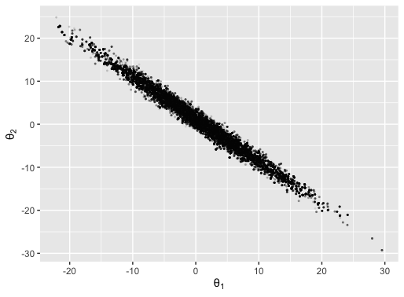
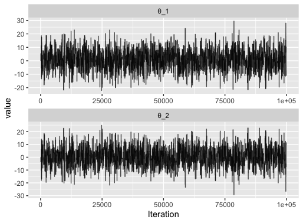

--- 
title: "ilike documentation"
author: "Richard G. Everitt"
date: "`r Sys.Date()`"
site: bookdown::bookdown_site
output: bookdown::gitbook
documentclass: book
bibliography: [ilike_documentation.bib, packages.bib]
biblio-style: apalike
link-citations: yes
github-repo: richardgeveritt/ilike_documentation
description: "Documentation for the ilike R package."
---

# Preface

```{r include=FALSE}
# automatically create a bib database for R packages
knitr::write_bib(c(
  .packages(), 'bookdown', 'knitr', 'rmarkdown'
), 'packages.bib')
```

This book provides documentation for the R package `ilike`, which can be [accessed here](https://github.com/richardgeveritt/ilike). The package can be installed using the following command in R:

```{r,eval=FALSE}
devtools::install_github("richardgeveritt/ilike")
```

This installation will take some time, so go and make a cup of tea (or even lunch?) at this point.

The ilike package contains functions that implement Bayesian computation techniques, focussed on cases when the likelihood is intractable. The functions in the package use statistical models written in the **ilike language**, in a file with the extension `.ilike` (hereby referred to as an ilike file). An ilike file holds the data, the model (priors and likelihoods) and the settings of the inference algorithms. Models can be written directly as statements, as in BUGS, JAGS or Stan (`theta ~ norm(0, 1)`), or by functions written in C++, R, Python or Julia, or by a mixture of the two. Inference algorithms included in the package are:

* importance sampling (IS);
* Markov chain Monte Carlo (MCMC);
* sequential Monte Carlo (SMC);
* particle filters (PFs);
* Kalman filters (KFs) and ensemble Kalman filters (EnKFs).

ilike files include the option to estimate the likelihood using any of the inference algorithms above (with the exception of MCMC), alongside:

* an exact likelihood;
* approximate Bayesian computation (ABC);
* synthetic likelihood (SL).
<!-- * iterative ensemble Kalman inversion ABC (IEnKI-ABC). -->

We begin the documentation in section \@ref(toy-example) by giving an example of how to use the package, from (a) writing the ilike file and compiling it, to (b) calling the function that runs the inference algorithm, then (c) visualising the output of the algorithm. The documentation then follows the same order, providing full details about every step: chapter \@ref(ilike-files) describes ilike files, chapters \@ref(models) and \@ref(ssm) the models that can be written in them, chapters \@ref(inference) to \@ref(smc) the inference algorithms and their settings, and chapter \@ref(functions) how to write functions in C++, R, Python and Julia. Files written in the earlier format of ilike files (with `/***…***/` headers) can still be read; appendix \@ref(old-format) describes that format and how to convert files from it.

## Example {#toy-example}

### The model

We are going to use the ilike package to run MCMC to approximate the posterior distribution of a two-dimensional parameter $\theta = (\theta_1,\theta_2)$, where $\theta_1 + \theta_2$ gives the mean of a normal distribution with standard deviation 1.

The model used is:

$$
\theta \sim \mathcal{MVN}(\mathbf{0}_2,100 \mathbf{I}_2),
$$
$$
y_i \sim \mathcal{N}(\theta_1 + \theta_2,1), \quad i = 1, \ldots, 100,
$$
where $\mathbf{0}_2$ is the 2-dimensional column vector of zeros and $\mathbf{I}_2$ is the 2-dimensional identity matrix. We fit this model to 100 observations of $y$ drawn from a standard normal distribution.

### ilike file

The code below gives an example of a valid ilike file, `first.ilike`.

```{r, echo=FALSE, comment=""}
cat(readLines("examples/language/first.ilike"), sep = "\n")
```

Let's not get too hung up on all of the details yet - let's instead focus on the structure of the file. After the first line, which says that the file is written in version 1.0 of the ilike language, it contains five *sections*, each of which is a keyword followed by braces `{ }`:

1. `data { … }` gives the data. Here the data `y` is the result of calling the R function `get_data()`; `r::` says that `get_data` is an R function.

2. `constants { … }` declares the constants of the file: values that are given when the file is used, by name. Here the constant `proposal_covariance` is the covariance of the MCMC proposal. It has no default value, so it must be given when the algorithm is run.

3. `model { … }` gives the model, in statements that look like the mathematical description above. `theta ~ mvnorm(…)` gives the prior of `theta`; `for (i in 1:100) y[i] ~ norm(…)` gives the distribution of each of the 100 observations. Elements of vectors are numbered from 1, as in R. The vectors and matrices are written in square brackets: `[0, 0]` is a vector and `[[100, 0], [0, 100]]` is a matrix, written row by row. **Important note:** distributions in ilike are named as in R (without the `d`, `r`, `p` or `q` prefix), with the same parameters: `norm(mean, sd)` takes a standard deviation, not a variance or a precision as in BUGS.

4. <code>r { … }</code> holds R code: here the function `get_data`, used in the data section.

5. `algorithm mcmc { … }` gives the settings of an inference algorithm, named `mcmc`. `move m = metropolis(…)` describes one MCMC move, called `m`: a Metropolis move with a multivariate normal random walk proposal on `theta`, whose covariance is the constant `proposal_covariance`. `termination = iterations(100000)` says that the MCMC will be terminated after 100000 iterations. A file may have several algorithm sections, with different names.

The data, model and algorithm sections together provide everything needed to run the Metropolis algorithm: we refer to this as a "recipe". To use the file it must first be compiled into an ilike "recipe" object. To do this we call

```{r,eval=FALSE}
library(ilike)
recipe = compile("first.ilike")
```

Compiling turns the model statements into C++ code and compiles it, so this takes a few seconds the first time; a file that has been compiled before is found in a cache, so compiling it again is quick.

### Running MCMC

We run the Metropolis algorithm on this recipe by calling:

```{r,eval=FALSE}
MCMC(recipe,
     results_name = "first",
     initial_values = list(list(theta = c(0, 0))),
     model_parameter_list = list(proposal_covariance = 0.01 * diag(2)))
```

The first argument is the `recipe` we compiled in the previous step. `results_name` specifies the folder where the results will be written. `initial_values` gives the initial values of the chain. `model_parameter_list` gives the values of the constants, by name: here the proposal covariance. The recipe has only one algorithm section, so `MCMC` uses it; with several, the one to use is chosen with `algorithm = "mcmc"`.

No output is provided to the R console on running an MCMC algorithm - it can be found in the folder `results_name`, which is created in the current working directory. The following section gives an example of loading the output into R, and plotting it.

### Visualising the output

The ilike package contains functions for loading the output from ilike algorithms into R, in a format amenable to summarising or plotting. For this simple example, we can plot the output as a scatter plot using the [`ggsmc`](https://CRAN.R-project.org/package=ggsmc) package.

```{r,eval=FALSE}
output = load_mcmc_output("first")
library(ggsmc)
plot_scatter(output, x_parameter = "theta", x_dimension = 1, y_parameter = "theta", y_dimension = 2, mcmc = TRUE)
```



We can plot trace plots using, for example, [`ggmcmc`](https://CRAN.R-project.org/package=ggmcmc)

```{r,eval=FALSE}
output = load_mcmc_output("first", ggmcmc = TRUE)
library(ggmcmc)
ggs_traceplot(output)
```


