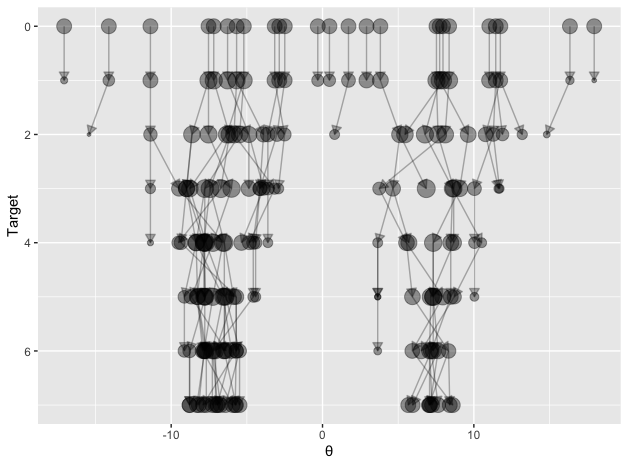
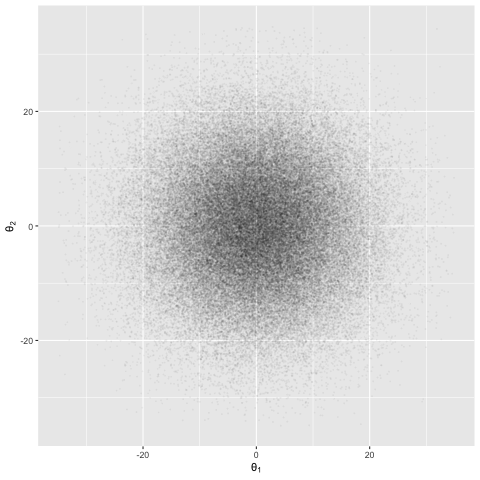

# Inference algorithms {#inference}

This chapter describes how to run the various inference algorithms implemented in the ilike package, with a section devoted to each algorithm. Preceding these sections, section \@ref(inference-arguments) describes the arguments that are common to all of the inference algorithms which allow, for example, the user to specify parameters, the random number seed, etc.

When developing ilike, much of the focus has been on Bayesian computation, although the software can be used to simulate from and perform optimisation on any distribution. In this chapter we provide a descriptions of the algorithms implemented in the software. To aid these descriptions we begin by setting out some notation.

Most algorithms are used to estimate properties of a *target* distribution $\pi$ on a space $\Theta$. In most cases, $\pi$ is only known up to a normalising constant: we use $\tilde{\pi}$ to denote its unnormalised form with $Z$ as the corresponding normalising constant, so that

$$
\pi(\theta) = \tilde{\pi}(\theta)/Z.
$$

In the case of Bayesian computation, the target distribution is the *posterior* distribution of parameters $\theta \in \Theta$ given data $y$. In this case we have

$$
\tilde{\pi}(\theta) = p(\theta)f(y|\theta),
$$
where $f(y|\theta)$ is a *data model* for $y$ given $\theta$ and $p(\theta)$ is a *prior* distribution. When $f(y|\theta)$ is thought of as a function of $\theta$ with $y$ fixed, it is known as a *likelihood*. The normalising constant $Z$ is the marginal likelihood of the data $y$:
$$
Z = \int_{\vartheta} p(\vartheta) f(y \mid \vartheta) d \vartheta.
$$
Quantities of interest in Bayesian computation are almost always integrals. For example:

- the posterior expectation

$$
\mathbb{E}_{\pi}\left[ \theta \right] = \int_{\theta} \theta \pi(\theta) d\theta,
$$

- or the posterior variance

$$
\mathbb{V}_{\pi}\left[ \theta \right] = \mathbb{E}_{\pi}\left[ h(\theta) \right] = \int_{\theta} h(\theta) \pi(\theta) d\theta,
$$

where $h(\theta) = \left( \theta - \mathbb{E}_{\pi}\left[ \theta \mid y \right] \right)^2$.

When using Monte Carlo methods to estimate these integrals, we use the philosophy of approximating the target distribution $\pi$ by a sample $\left\{ \theta^i \right\}_{i=1}^n$ using

$$
\hat{\pi} := \frac{1}{N} \sum_{i=1}^N \delta_{\theta^i},
$$
where $\delta_{\theta^i}$ is the delta Dirac mass at $\theta^i$. Monte Carlo estimators of integrals then follow from plugging in the approximation $\hat{\pi}$ in place of the target distribution $\pi$. For example, the Monte Carlo estimator of the posterior expectation is
$$
\hat{\mathbb{E}}_{\pi}\left[\theta \right] = \frac{1}{n} \sum_{i=1}^n \theta^i.
$$

We may also be interested in maxima of the likelihood (the maximum likelihood estimator, MLE) or the posterior distribution (the maximum *a posteriori* estimator, MAP).

One feature of the ilike package is the ability to use estimated likelihoods: for example using a particle filter for estimating the likelihood when using particle MCMC (section \@ref(algorithmic-likelihood)). A user might wonder at the validity of this approach when mixing and matching estimated likelihoods with different inference algorithms. Fortunately, this is easy to justify: when the estimate of the likelihood is unbiased, each algorithm targets the correct distribution, through the pseudo-marginal argument [@andrieu2010particle].

## Inference algorithm arguments {#inference-arguments}

All inference algorithms have the following arguments in common. All users are encouraged to read about the first two items on this page: the `recipe`, which is the means for providing ilike with the functions used in the inference algorithm and is required in all runs of an ilike algorithm; and the `results_name`, which is used in most circumstances.

### `recipe` (required)

Every inference algorithm requires the specification of a model, in most cases additionally some observed data and parameters required by the inference algorithm (collectively referred to in this documentation as a "recipe"). These are written in ilike files by the user (see chapter \@ref(ilike-files)). The `recipe` argument for an inference algorithm can be provided in three possible ways:

1. Compiled, as an ilike recipe object, through the `compile` function (section \@ref(compiling)). Using a pre-compiled model is the most suitable approach where you wish to perform multiple runs of the same algorithm on the same model/data, where some constants are changed from one run to the next.

2. As the filename of an ilike file. This is a suitable approach when performing a single run of an algorithm on a particular model/data.

3. Where the recipe is specified across multiple files, as a vector of filenames of ilike files. This is a useful approach when performing a single run of an algorithm, and where it is advantageous to divide the specification of the model and algorithm across multiple files (maybe when you wish to specify the model separately from the inference algorithm).

### `results_name` (optional)

`results_name`, specifies the folder where the results will be written. A new folder with this name will be created in the `results_path` directory. If the folder already exists, you will be prompted to check that you are ok with overwriting the contents of the folder. The default is for no results to be written to file.

The results written to file depend on which algorithm is called. For MCMC, the folder contains the raw output of the chains; the IS or SMC, the weighted points. Cases in which the user may not wish to output to a file are when only, for example, evaluations of a model are required (when calling `evaluate_log`) or when ilike is being used to estimate a normalising constant (e.g. from IS or SMC). In these situations the function will return a numeric argument yielding the desired result.

### `results_path` (optional)

The name of the directory where the folder with name `results_name` will be written. The default is the current working directory.

### `algorithm` (optional)

The name of the algorithm section of the recipe to run (section \@ref(algorithm-sections)). It may be left out when the recipe has only one algorithm section.

### `model_parameter_list` (optional)

The values of the recipe's constants (section \@ref(constants)), as a named list: `model_parameter_list = list(Sigma0 = diag(2), n_iter = 50000)`. Constants with defaults need not be given. Constants whose values are needed when compiling (those used in model statements, for example) are given to `compile()` instead; see section \@ref(constants).

(For a recipe in the earlier format of ilike files, appendix \@ref(old-format), the list is unnamed, and its elements are the values of `p1`, `p2`, … in order.)

### `fixed_parameter_list` (optional)

In C++ functions, for example those provided for evaluating a prior or likelihood, it is possible to make use of parameters that are stored in the `Parameters` object passed into the function. In most cases these parameters will be those that are being inferred using, for example, an MCMC algorithm. However, it is also possible to make use of other parameters that are treated as fixed throughout the run of the inference algorithm. These must be specified at runtime as fixed parameters in the named list `fixed_parameter_list`. This approach is suitable when you wish to complile the recipe only once, but wish to perform multiple runs of the algorithm using different values for these fixed parameters.

### `external_packages` (optional)

If the ilike file contains R functions (see section \@ref(functions-other-languages)) that make use of packages, their names must be provided here. Each package name must be an element in a vector of strings (e.g. `external_packages = c("distributional", "mvtnorm"))`.

### `julia_bin_dir` (optional)

If the ilike file contains Julia functions (see section \@ref(functions-other-languages)), the path to the Julia binary must be provided here.

### `julia_required_libraries` (optional)

If the ilike file contains Julia functions (see section \@ref(functions-other-languages)) that make use of Julia libraries, their names must be provided here. Each package name must be an element in a vector of strings (e.g. `julia_required_libraries = c("Distributions", "StatsBase"))`.

### `keep_temporary_recipe_code` (optional)

If `TRUE`, the C++ file generated when compiling the ilike file is kept, and its name printed. This can be useful for debugging purposes. The default is `FALSE`.

### `seed` (optional)

The random number seed. If not provided, a random seed will be generated.

### `parallel` (optional)

This argument is available for the Monte Carlo algorithms (`IS`, `MCMC`, `SMC_with_MCMC`, `PF`, and the ensemble Kalman methods). If `TRUE`, the points (or particles, or chains) are divided into chunks of `grain_size`, and the chunks are processed in parallel threads. The number of threads is set with `RcppParallel::setThreadOptions(numThreads = ...)` (by default, all available cores). The default is `FALSE`.

For `IS`, `MCMC`, `SMC_with_MCMC` and `PF`, a parallel run gives *exactly* the same results as a sequential run with the same `seed` and `grain_size`: each chunk has its own random number stream, determined by the seed and the position of the chunk, so it does not matter which thread processes it, or in which order. This makes parallel runs reproducible.

Parallel runs require:

- a recipe whose functions are written in C++, as model statements, or are ilike built-in functions (functions written in R, Python or Julia cannot be called from several threads at once);
- for `SMC_with_MCMC`: exact or annealed factors, and an MCMC termination with a fixed number of iterations (`termination = iterations(n)`);
- MCMC moves that do not adapt (section \@ref(adaptive-mcmc)).

If these are not met, the run (or the part of it that cannot be done in parallel) is done sequentially, with a warning. Resampling and the writing of output are always sequential.

When the likelihood is itself estimated by an algorithm (e.g. a particle filter inside particle marginal Metropolis-Hastings, see section \@ref(algorithmic-likelihood)), parallelism can be used in either of two places: the outer algorithm can run its points in parallel (each with its own inner filter), or the inner filter can run its particles in parallel (by setting its own `parallel` argument; see the particle filter's arguments in section \@ref(algorithmic-likelihood)). Running the outer algorithm in parallel usually gives the larger gain.

### `grain_size` (optional)

This argument is available for the Monte Carlo algorithms. For `IS`, `MCMC`, `SMC_with_MCMC` and `PF`, it is the number of points (or particles, or chains) processed together as one chunk. The defaults are `256` for `IS` and `64` for `MCMC`, `SMC_with_MCMC` and `PF`.

Since each chunk has its own random number stream (see `parallel`), results depend on both the `seed` and the `grain_size` (when there are more points than `grain_size`), but not on whether the run is parallel. Smaller chunks give more chunks to share between threads; larger chunks reduce the overhead of managing them. When the likelihood is estimated by an inner algorithm, larger chunks use more memory, since each point of a chunk keeps its inner particles until the chunk has been weighted. The defaults work well in most cases.

For the ensemble Kalman methods (`EnKF`, `IENKI`), `grain_size` is the minimum chunk size used by the parallelisation library (default `100000`; see [guidance here](https://oneapi-src.github.io/oneTBB/main/tbb_userguide/Controlling_Chunking_os.html)).

### `progress` (optional)

If `TRUE`, a progress bar is shown while the algorithm runs. The default is `getOption("ilike.progress", interactive())`: a progress bar is shown in interactive sessions only. To switch progress bars off for a whole session, use `options(ilike.progress = FALSE)`.

### `write_factor_output` (optional)

If `TRUE` (the default), the output of each factor at each point is written along with the points: for example, the particles of a particle filter used to estimate the likelihood, which are needed to load nested output with `load_smc_output(..., nesting_level = 1)` (section \@ref(output)). If `FALSE`, only the points, their weights and the estimates of the normalising constant are written, which saves time and disk space.

### Settings in files and in R {#settings-in-files}

The arguments of the inference functions that describe the run, such as `number_of_particles`, `number_of_chains`, `grain_size` or `smc_iterations_to_store`, may also be written in the algorithm section of the recipe:

```
algorithm filter {
  particles = 500
  iterations_to_store = 3
}
```

Each such setting has the same name as the argument, or the argument's name without its `number_of_` prefix (`particles` for `number_of_particles`, `chains` for `number_of_chains`), and `iterations_to_store` for the argument ending `_iterations_to_store`. An argument given in the call to the R function overrides the setting in the file. A setting that is not an argument of the function being run is an error, which lists the settings that the function accepts.

The same names are used for the settings of an algorithmic likelihood (section \@ref(algorithmic-likelihood)): `factor f = pf(inner, particles = 500)` runs the filter with 500 particles, and, without `particles`, with the `particles` setting of `inner`'s algorithm section, which is also what `PF` uses when the file `inner.ilike` is run from R. So a model file behaves in the same way whether it is run from R or used inside another file.

### Stopping a run

A run can be stopped at any time in the usual way (pressing Esc in RStudio, or Ctrl-C in a terminal). ilike checks for an interrupt between chunks of points, between SMC iterations, and every 1024 iterations of a long MCMC chain, so a run stops shortly after the request (a parallel run stops when its current set of chunks is finished). The function then returns nothing; output already written to file remains. The next run works as normal.

## Importance sampling {#inference-is}

### Algorithm

Importance sampling (IS) is used to approximate a target distribution $\pi$ through drawing $n$ points from a *proposal* distribution $q$. Each point $\theta^i$ drawn from $q$ is assigned an (unnormalised) *importance weight*:
\begin{equation}
\tilde{w}^i = \frac{\tilde{\pi}(\theta^i)}{q(\theta^i)} (\#eq:is-weight)
\end{equation}
An approximation $\hat{\pi}$ to the target distribution is then given by
$$
\hat{\pi} := \sum_{i=1}^n w^i \delta_{\theta^i},
$$
where the normalised weights $w^i$ are given by
$$
w^i = \frac{\tilde{w}^i}{\sum_{j=1}^n
\tilde{w}^j}
$$
An estimate of the normalising constant $Z$ is given by
\begin{equation}
\hat{Z} = \frac{1}{n} \sum_{i=1}^n \tilde{w}^i. (\#eq:is-Z)
\end{equation}

For a comprehensive description see @chopin2020introduction.

The R function `IS` implements importance sampling in ilike. The function returns the normalising constant estimator from equation \@ref(eq:is-Z), along with writing output to the specified `results_name` directory.

In addition to the arguments described in section \@ref(inference-arguments), the `IS` function only has one additional argument:

- `number_of_importance_points` (required) This argument provides the number of importance points $n$ to be drawn from the proposal distribution $q$.

Section \@ref(smc-output) describes how to visualise the output of an IS algorithm after it has finished running.

### ilike recipe requirements {#requirements-is}

To run an importance sampler, we need to be able to:

1. simulate from the proposal $q$;

2. in order to implement equation \@ref(eq:is-weight), evaluate $q$ pointwise at $\theta$;

3. in order to implement equation \@ref(eq:is-weight), evaluate the unnormalised target $\tilde{\pi}$ pointwise at $\theta$;

Points 1 and 2 require a proposal to be fully specified (simulation and evaluation) in the recipe, through the `proposal` setting of the algorithm section (section \@ref(is-proposal)). Point 3 requires the target distribution to be fully specified, via a model (chapter \@ref(models)).

There is one exception to this rule: in the case of Bayesian computation where the prior $p$ is chosen as the proposal $q$. In this case equation \@ref(eq:is-weight) simplifies to
$$
\tilde{w}^i = \frac{\tilde{\pi}(\theta^i)}{q(\theta^i)} = \frac{p(\theta^i) f(y\mid \theta^i) }{p(\theta^i)} = f(y\mid \theta^i),
$$
so that to implement IS we need only to be able to simulate from the prior $p$ and evaluate the likelihood $f$. In this case the recipe may be entirely specified through the model (chapter \@ref(models)), and the `IS` function will automatically use the prior as the proposal when no `proposal` is given. Only a method for simulating from the prior is then needed: priors written as model statements, and built-in priors, can always be simulated; a prior written as a function needs `simulate` (section \@ref(user-factors)). The algorithm section may then be empty (`algorithm is { }`), or hold settings such as `importance_points = 1000`.

## MCMC {#inference-mcmc}

### Algorithm

Markov chain Monte Carlo (MCMC) uses a Markov chain whose limiting distribution is the desired target distribution $\pi$ to generate points that can be used to approximate $\pi$. In most cases in practice this boils down to implementing the Metropolis-Hastings (MH) algorithm:

-----

**Metropolis-Hastings**

| *Starting with* $\theta^0$ iterate for $i=1,2,\dots,n$
|     *Draw* $\theta^* \sim q(\cdot\mid \theta^{i-1})$.
|     *Compute*
|
|    $$\alpha(\theta^* \mid \theta^{i-1})=\min\left\{1,\frac{\displaystyle \tilde{\pi}(\theta^*) q(\theta^{i-1}\mid \theta^*)}{\tilde{\pi}(\theta^{i-1}) q(\theta^*\mid \theta^{i-1})} \right\}.$$
|
|    *With probability* $\alpha(\theta^* \mid \theta^{i-1})$ set $\theta^i=\theta^*$, otherwise set $\theta^i=\theta^{i-1}$.
| **OUTPUT:** $\left\{\theta^i\right\}_{i=1}^n$

-----

Here $q$ is *proposal* distribution that is used at each iteration to propose a candidate point $\theta^*$ conditional on the current state of the chain $\theta^{i-1}$. The choice of proposal dramatically affects the efficiency of the algorithm. 

Despite the apparent simplicity of this algorithm, MCMC encompasses a wide range of different approaches. Most well-known methods, including Gibbs sampling, MALA, HMC and NUTS are special cases of MH. For a description of a number of common approaches, see @brooks2011handbook.

Most of the specification of an MCMC algorithm in ilike is done in the recipe's algorithm section: see chapter \@ref(mcmc) for full detail. Section \@ref(mcmc-output) then describes how to visualise the output of the MCMC algorithm after it has finished running. In this section we only describe how to run the MCMC algorithm, through calling the `MCMC` function.

`MCMC` does not return anything^[MCMC output does not provide any useful direct estimate of $Z$. So in order to be be consistent with other inference algorithms which return the an estimate of $Z$.], but writes output to the specified `results_name` directory. In addition to the arguments described in section \@ref(inference-arguments), `MCMC` takes the arguments:

- `initial_values` (optional) A list of lists containing the initial values for the chains. If it is not given, each of the `number_of_chains` chains starts at an independent draw from the algorithm section's importance proposal (the `proposal` setting, section \@ref(is-proposal)), or from the prior if it has none. Otherwise, the list gives the initial values directly. The length of the outer list should be equal to the number of chains; the inner list specifies the initial values of the parameters for each chain. For example, for a single chain on a model with parameters $\alpha$ and $\beta$, if we wanted the initial values to be 1 and 2 respectively, we would use

```{r}
initial_values = list(list(α=1, β=2))
```

In the, relatively common, case where we would like to start multiple chains at the same point, one solution is to use the `replicate` function to repeat the initial values. For example, to start 3 chains at the same point, we would use

```{r}
initial_values = replicate(3, list(α=1, β=2), simplify=FALSE)
```

- `number_of_chains` (optional) The number of MCMC chains to run (default is 1). If initial values are given, the number of chains is the number of initial values.

- `thin` (optional) Store only every `thin`th iteration of each chain (default is 1: every iteration is stored). There is no burn-in argument: discard the early iterations when analysing the output (section \@ref(mcmc-output)).

- `check_factor_index` (optional) If `TRUE`, after every accepted update that has a factor index, re-evaluate the exact factors left out of the update and stop with an error if any changed value, that is, if one of them does not in fact cancel in the acceptance ratio (default `FALSE`; slower, intended for checking a model file; see section \@ref(selecting-factors)).

MCMC moves can adapt their proposals as the chains run (adaptive MCMC): see section \@ref(adaptive-mcmc). Each chain then adapts its own proposal, and the adapted parameters can be loaded with `load_mcmc_adaptation` (section \@ref(mcmc-output)).

### ilike recipe requirements {#requirements-mcmc}

To run an MCMC algorithm the user needs to provide the following in the algorithm section:

1. one or more moves for updating the chain (`move m = metropolis(…)`);

2. the criterion for terminating the chain (`termination = iterations(10000)`).

A complete description is provided in chapter \@ref(mcmc).

## SMC with MCMC moves {#inference-smc}

### Algorithm

The performance of IS poor when the distance between the proposal $q$ and the target $\pi$ is large. In this situation, the the points drawn from $q$ may be a long way from $\pi$, and the points need to be reweighted dramatically in order to provide an approximation to $\pi$. The thing to watch out for is when the variance of the weights is very large: this likely indicates that a few of the points have a large weight, and most of the others have a very small weight. In this case, the approximation of $\pi$ will essentially be based on this small number of points that have a large weight.

Sequential Monte Carlo (SMC) samplers [@del2006sequential] make use of an iterative IS-based approach to approximate a target distribution. One way of viewing SMC samplers is as an enhancement of IS that is less dependent on the choice of initial proposal. The idea is to construct a sequence of distributions between the proposal and the target, providing a "path" of $T$ targets through which we move a population of weighted importance points ("particles"). We provide only a bare-bones introduction to SMC here: a comprehensive description is given by @chopin2020introduction.

The sequence of distributions is denoted by $\pi_t$ for $t=0:T$, with $\pi_0 = q$ and $\pi_T = \pi$. We use $\tilde{\pi}_t$ to denote an unnormalised version of $\pi_t$ at iteration $t$, with a normalising constant of $Z_t$. We denote the position of the particles at the $t$th iteration by $\left\{ \theta^i_t \right\}_{i=1}^n$, with their weights being given by $\left\{ w^i_t \right\}_{i=1}^n$. At the $t$ iteration, three operations are performed:

- **Move.** Each of the particles is moved using a Markov kernel $K_t(\cdot \mid \theta^i_{t-1})$ to diversify the particle positions.

- **Reweight.** An IS step is used to reweight the particles such that the weighted particle population can be used to approximate the target $\pi_t$. This step consists of calculating unnormalised weights $\left\{ \tilde{w}^i_t \right\}_{i=1}^n$, then normalising them to give $\left\{ w^i_t \right\}_{i=1}^n$, similarly to IS.

- **Resample.** Particles are resampled with replacement according to their weights, and their weights are all set to $1/n$. Although resampled particles will include a number of duplicate particles, this step ensures that the unweighted particles (i.e. the particle positions) approximate the target $\pi_t$.

An illustration of the output SMC algorithm (generated using `ilike` and plotted using the `plot_genealogy` function in `ggsmc`) is shown in the figure below, where the proposal (top) is a Gaussian distribution, the target (bottom) is a mixture distribution, and the size of the points represents their weights.



A further illustration, on a different example, is shown in the animation below (also generated using `ilike` and plotted using the `animate_scatter` function in `ggsmc`).



The sequence of distributions is typically chosen such that the distance between successive distributions is small, with the aim that at step $t$, the particles from step $t-1$ do not need dramatically reweighting (we wish the variance of the weights to be small) to approximate $\pi_t$. One sequence of distributions that is commonly chosen in practice (including in the examples above) is $\pi_t \propto q^{1-\alpha_t} \pi^\alpha$, with $0 = \alpha_0 < \alpha_1 < ... < \alpha_{T} = 1$. This is commonly known as "annealing" or "tempering".

The choice of the sequence of distributions significantly affects the performance of the algorithm, as does the choice of $K$, which moves the points at each iteration. In ilike, the choice of $K$ is currently restricted to an MCMC kernel, which is specified in the same way as described in chapter \@ref(mcmc). One use-case for ilike is that, having specifed an MCMC move, it is easy to use it in an SMC sampler as well as in a run of MCMC.

Most of the specification of an SMC algorithm in ilike is done in the recipe's algorithm section: see chapter \@ref(smc) for full detail. Section \@ref(smc-output) then describes how to visualise the output of the SMC algorithm after it has finished running. In this section we only describe how to run the SMC algorithm, through calling the `SMC_with_MCMC` function.

`SMC_with_MCMC` returns the estimate of the normalising constant $Z$ calculated from SMC output using

$$
\hat{Z} = \prod_{s=0}^t l^n_s \quad \mbox{where} \quad l^n_t = \frac{1}{n} \sum_{i=1}^n \tilde{w}^i_t.
$$
and also writes output to the specified `results_name` directory. In addition to the arguments described in section \@ref(inference-arguments), `SMC_with_MCMC` takes the arguments:

- `number_of_particles` (required) This argument provides the number of particles $n$.

- `smc_iterations_to_store` (optional) This argument provides the number of SMC iterations to store in the output, counting backwards (inclusive) from the final iteration. The default is to store the minimal number of iterations required to perform the SMC updates (which is 2 in the current version of ilike). If the user wishes to examine the entire SMC history, they should choose a number that is equal to or larger than $T+1$. If only points from the final target as required, and memory requirements are a concern due to the output only being written to file at the end of the run (see below), then the default values is recommended.

- `write_to_file_at_each_iteration` (optional) This boolean argument allows the user to choose if the output will be written to the file at the end of every iteration (use TRUE, which is also the default), or if the output of each SMC iteration will be written to file between iterations (use FALSE).

- `waste_free_chains` (optional) If greater than 0, run waste-free SMC [@dau2022waste] with this number of chains $M$ (see below). $M$ must divide `number_of_particles`. The default is 0: standard SMC.

### Waste-free SMC {#waste-free-smc}

In standard SMC, each of the $n$ particles is moved by an MCMC kernel, and only the final state of each MCMC chain is kept. Waste-free SMC [@dau2022waste] keeps every state instead. At each iteration, $M$ particles are resampled from the $n$ weighted particles, and each is used to start an MCMC chain of length $n/M$ (the resampled particle itself, followed by $n/M - 1$ MCMC moves). All $n$ states of the $M$ chains then form the next population of particles, which are reweighted for the next target as usual. With the same number of likelihood evaluations as standard SMC with one move per particle, the states that standard SMC would discard are used, and the length of the chains ($n/M$) replaces the number of MCMC iterations as the tuning parameter: longer chains (smaller $M$) suit targets on which the MCMC kernel mixes slowly. @dau2022waste suggest choosing $M$ so that $n/M$ is in the range of tens to hundreds.

For example, with `number_of_particles = 10000` and `waste_free_chains = 100`, each iteration runs 100 chains of 100 states. When waste-free SMC is used, the number of MCMC moves is set by the chain length, whatever the `termination` of the moves says, and the estimate of the normalising constant is computed from all $n$ states.

Waste-free SMC requires exact or annealed factors, an MCMC move that does not adapt, and the moves' termination set to `iterations(n)`.

### ilike recipe requirements {#requirements-smc}

To run an SMC algorithm with MCMC moves the user needs to provide the requirements described in both \@ref(requirements-is) (for IS) and \@ref(requirements-mcmc) (for MCMC), in one algorithm section. As in IS, in the case of Bayesian computation, if the proposal is not specified, the prior will be used by default.

There are no other essential requirements to ensure that an SMC algorithm will run. However, if no sequence of distributions is set, the algorithm will default to performing IS. Thus the user should specify a sequence of distributions (`sequence = annealing(…)`) as described in section \@ref(smc-sequence).

A complete description is provided in chapter \@ref(smc), including options to adaptively choose the sequence of distributions and to resample adaptively.

## Particle filters {#inference-pf}

Particle filters (PFs) are a particular type of SMC algorithm (as in the previous section, section \@ref(inference-smc)), where the sequence of distributions is determined by a state-space model (SSM).

An SSM describes the evolution of an indirectly observed latent "state" variable over time (from 0 to $T$). We denote the state at time $t$ as $x_t$ and the observation at time $t$ as $y_t$. A Markov assumption is made on the state, so that the distribution of $x_t$ depends only on $x_{t-1}$. Along with the prior distribution at time 0, denoted $p$, the distribution of $x_t \mid x_{t-1}$, known as the transition/dynamic model, is sufficient to describe the distribution on the latent state. We denote this distribution using $p_t$.

A further conditional independence assumption is made that $y_t$ is conditionally independent of all other variables in the system given $x_t$. The distribution of $y_t$ given $x_t$, which we denote using $f_t$, is known as the measurement/observation model. Together this provides a joint distribution over variables $x_{0:T}$ and $y_{0:T}$:

$$
p\left( x_0 \right) \prod_{t=1}^T p_t\left(x_t \mid x_{t-1} \right) \prod_{t=0}^T f_t \left( y_t \mid x_t \right).
$$
SSMs are also used in sections \@ref(inference-enkf) and \@ref(inference-kf). We describe how to specify an SSM in ilike in chapter \@ref(ssm).

PFs are focused on the inference goal of *filtering*: i.e. given measurements up to time $t$, inferring $\pi_t\left( x_t \mid y_{0:t} \right)$. As a by-product they also provide an estimator of the normalising constant $Z_t = p\left( y_{0:t} \right)$. A PF iteratively approximates $\pi_t\left( x_t \mid y_{0:t} \right)$ using a population of particles $\left\{ x^i_t \right\}_{i=1}^n$, with weights $\left\{ w^i_t \right\}_{i=1}^n$ through an SMC algorithm that use the following steps at iteration $t$ (on receipt of measurement $y_t$):

- **Move.** Each of the particles is moved using a Markov kernel $q_t(\cdot \mid x^i_{t-1})$, which we call a *transition proposal*, to move the points from their positions at iteration $t-1$ to new positions at time $t$.

- **Reweight.** An IS step is used to reweight the particles such that the weighted particle population can be used to approximate the target $\pi_t$. This step consists of calculating unnormalised weights $\left\{ \tilde{w}^i_t \right\}_{i=1}^n$, then normalising them to give $\left\{ w^i_t \right\}_{i=1}^n$, similarly to IS.

- **Resample.** Particles are resampled with replacement according to their weights, and their weights are all set to $1/n$. Although resampled particles will include a number of duplicate particles, this step ensures that the unweighted particles (i.e. the particle positions) approximate the target $\pi_t$.

Most of the specification of an PF algorithm in ilike is done through the recipe (see section \@ref(requirements-pf)). The `PF` function is used to run a PF, which returns the estimate of the normalising constant $Z_T$ (for $T$ measurements) calculated from PF output using

$$
\hat{Z_T} = \prod_{s=0}^t l^n_s \quad \mbox{where} \quad l^n_t = \frac{1}{n} \sum_{i=1}^n \tilde{w}^i_t.
$$
and also writes output to the specified `results_name` directory. In addition to the arguments described in section \@ref(inference-arguments), `PF` takes the arguments:

- `number_of_particles` (required) This argument provides the number of particles $n$.

- `smc_iterations_to_store` (optional) This argument provides the number of SMC iterations to store in the output, counting backwards (inclusive) from the final iteration. The default is to store the minimal number of iterations required to perform the SMC updates (which is 2 in the current version of ilike). If the user wishes to examine the entire SMC history, they should choose a number that is equal to or larger than $T+1$. If only points from the final target as required, and memory requirements are a concern due to the output only being written to file at the end of the run (see below), then the default values is recommended.

- `write_to_file_at_each_iteration` (optional) This boolean argument allows the user to choose if the output will be written to the file at the end of every iteration (use TRUE, which is also the default), or if the output of each SMC iteration will be written to file between iterations (use FALSE).

As for an SMC sampler, section \@ref(smc-output) then describes how to visualise the output of the PF after it has finished running.

### ilike recipe requirements {#requirements-pf}

To use the function `PF`, the recipe must specify:

1. An SSM, as described in chapter \@ref(ssm).

2. Optionally, an IS proposal $q_0$, which is used to generate points at the 0th iteration of the PF (the `proposal` setting, section \@ref(is-proposal)). As in section \@ref(requirements-is), a method for simulating from and evaluating it must both be specified. If no proposal is specified, the prior of the SSM's initial state is used as the initial proposal, and only a method to simulate from the prior is required (similarly to section \@ref(requirements-is)).

3. Optionally, a transition proposal $q_t$ (the `transition_proposal` setting, chapter \@ref(ssm)). If no transition proposal is supplied, the transition model will be used as the transition proposal (the "bootstrap" filter). In this case, only an approach to simulating from the transition model need be supplied when specifying the model, since the transition model need not be evaluated in the PF weight update (via a similar argument to that seen in section \@ref(requirements-is)).

The algorithm section may hold the number of particles (`particles = 500`).

## Kalman filters {#inference-kf}

This section relies on ideas (state-space models, filtering) introduced in section \@ref(inference-pf) on particle filters.

Kalman filters (KFs) provide an exact solution to the filtering problem for a SSM in the case where the transition model $p_t(\cdot \mid x_{t-1})$ and measurement model $f_t(\cdot \mid x_{t})$ are both (multivariate) Gaussian and where the mean depends linearly on, for the transition model $x_{t-1}$ (equation \@ref(eq:lgtm)), and for the measurement model $x_{t}$ (equation \@ref(eq:lgdm)). In this case the filtering distribution at each iteration $t$ is also Gaussian and is fully described using a mean $\mu_t$ and covariance $\Sigma_t$. The update from the filtering distribution at time $t-1$ to time $t$ can be described via matrix operations on the mean and covariance.

ilike contains a straightforward implementation of the KF^[This implementation is currently unlikely to be as robust as those found in some other packages. THus far it has only been tested on models where the standard implementation is well-behaved.]. The `KF` function is used to run a KF, which return the (exact) normalising constant $Z_T$ (for $T$ measurements) calculated from KF output.

 In addition to the arguments described in section \@ref(inference-arguments), `KF` takes the arguments:

- `kf_iterations_to_store` (optional) This argument provides the number of SMC iterations to store in the output, counting backwards (inclusive) from the final iteration. To be consistent with the PF, the default is to output the mean and covariance from the last 2 iterations. If the user wishes to examine the entire KF history, they should choose a number that is equal to or larger than $T+1$. If only the mean and covariance from the final target as required, and memory requirements are a concern due to the output only being written to file at the end of the run (see below), then the default values is recommended.

- `write_to_file_at_each_iteration` (optional) This boolean argument allows the user to choose if the output will be written to the file at the end of every iteration (use TRUE, which is also the default), or if the output of each SMC iteration will be written to file between iterations (use FALSE).

### ilike recipe requirements

The KF requires only the specification of a linear-Gaussian SSM, following chapter \@ref(ssm): the transition model is `transition x = linear_gaussian(…)`, and the measurement model `factor obs = linear_gaussian(…)` (section \@ref(gaussian-data-models)). The prior on the initial state $x_0$ must be Gaussian and given by a simple prior: `x ~ norm(…)` for a one-dimensional state or `x ~ mvnorm(…)`. It describes $x_0$ only; the dynamics are given entirely by the transition model.

## Ensemble Kalman filters {#inference-enkf}

This section relies on ideas (state-space models, filtering) introduced in section \@ref(inference-pf) on particle filters.

Ensemble-Kalman filters provide an alternative to particle filters for the filtering problem in the case of non-linear/Gaussian measurement models. That is, the conditional distribution $f_t$ is Gaussian, where the mean is given by a possibly non-linear function of $x_t$ (equation \@ref(eq:nlgdm)).

The ensemble-Kalman filter (EnKF) is a Monte Carlo approximation of the Kalman filter. An *ensemble* $\left\{ x^i_t \right\}$ is used to approximate the filtering distribution $\pi_{t}$ at iteration $t$. The ensemble is updated from time $t-1$ to $t$ through a sequence of operations that, for a linear/Gaussian SSM, would result in the sample mean and covariance of the ensemble being estimators of the true mean and covariance of the filtering distribution. This is performed in two steps:

- *Prediction* where the ensemble is simulated from the transition model $x^i_t \sim p_t(\cdot \mid x^i_{t-1})$;

- *Update* where each member of the ensemble is moved such that the sample mean and variance of the updated ensemble estimate the mean and variance of the true filtering distribution.

Whilst the update is only exact in the linear/Gaussian case, the same sequence of operations can be used outside of this case to provide an approximation to the filtering distribution. @katzfuss2016understanding contains a useful review from the statistical perspective.

Most of the specification of an EnKF algorithm in ilike is done through the recipe (see the requirements below). The `EnKF` function is used to run an EnKF, which returns the estimate of the normalising constant $Z_T$ (for $T$ measurements) calculated from the EnKF output using the direct (biased) estimator described in @drovandi2022ensemble, and also writes output to the specified `results_name` directory. In addition to the arguments described in section \@ref(inference-arguments), `EnKF` takes the arguments:

- `number_of_ensemble_members` (required) This argument provides the number of ensemble members $n$.

- `enkf_iterations_to_store` (optional) This argument provides the number of EnKF iterations to store in the output, counting backwards (inclusive) from the final iteration. The default is to store the minimal number of iterations required to perform the EnKF updates (which is 2 in the current version of ilike). If the user wishes to examine the entire EnKF history, they should choose a number that is equal to or larger than $T+1$. If only points from the final target as required, and memory requirements are a concern due to the output only being written to file at the end of the run (see below), then the default values is recommended.

- `write_to_file_at_each_iteration` (optional) This boolean argument allows the user to choose if the output will be written to the file at the end of every iteration (use TRUE, which is also the default), or if the output of each EnKF iteration will be written to file between iterations (use FALSE).

Section \@ref(enk-output) describes how to visualise the output of the EnKF after it has finished running.

### ilike recipe requirements

The EnKF requires the specification of an SSM, following chapter \@ref(ssm). The transition model may be given in any way, but the measurement model must be a Gaussian data model, `linear_gaussian(…)` or `nonlinear_gaussian(…)` (section \@ref(gaussian-data-models)). The algorithm section may hold the number of ensemble members (`ensemble_members = 500`) and the shifter (`shifter = stochastic()`, `sqrt()` or `adjustment()`: the method for moving the ensemble at each update).

## Iterative ensemble Kalman inversion {#inference-enki}

Iterative ensemble Kalman inversion (IEnKI) uses the ensemble Kalman update to move an ensemble from the prior to the posterior of a model with a Gaussian likelihood, through a sequence of tempered targets $p(\theta) f(y \mid \theta)^{\phi_t}$ with $0 = \phi_0 < \phi_1 < \dots < \phi_T = 1$ [@iglesias2018bayesian]. The update is exact when the likelihood is linear-Gaussian and the prior Gaussian, and an approximation otherwise. The function `IENKI` returns an estimate of the log marginal likelihood, and writes the ensembles to `results_name` (loaded with `load_enk_output`, section \@ref(enk-output)). Its arguments are those of `EnKF`, with `enki_iterations_to_store` in place of `enkf_iterations_to_store`.

Since the update treats the parameters as Gaussian, positive or bounded parameters are better moved on a transformed scale: `transform = auto` in the algorithm section (or a list such as `transform = [log(sigma), logit(p)]`, with the transformations of section \@ref(move-transforms)) makes the ensemble start from the transformed prior sample and move on that scale, while the model is evaluated, and the ensembles are written, on the parameters' own scale. For example, with a log-normal prior on $\sigma$ and an observation $y = \sigma + \varepsilon$, the members of an ensemble on $\sigma$ itself went below zero, and stayed positive on $\log\sigma$.

```
algorithm enki {
  transform = auto
  sequence = annealing(power, [0, 0.1, 0.3, 0.6, 1])
}
```

The recipe needs a prior that can be simulated, a Gaussian data model (section \@ref(gaussian-data-models)), and, in the algorithm section, the sequence of powers and the shifter:

```{r, echo=FALSE, comment=""}
cat(readLines("examples/language/enki.ilike"), sep = "\n")
```

Without a `sequence`, the ensemble moves from the prior to the posterior in one step.

## Mean-field dynamical system ensemble Kalman inversion {#inference-mfds}

The function `MFDS` implements the derivative-free method of @huang2022efficient, in which the posterior is the fixed point of a filtering problem: at each iteration the ensemble is inflated about its mean and then updated by an ensemble Kalman step with an augmented observation (the data and the prior mean), with the noise scaled by $1/\Delta t$. For linear-Gaussian problems the ensemble's mean and covariance converge to the posterior's. `MFDS` estimates a posterior, not a normalising constant, so it is an algorithm in its own right and cannot be used as a likelihood. Its arguments include `number_of_ensemble_members`, `number_of_iterations` and `delta_t` (between 0 and 1; default 0.5), which may be written in the algorithm section as `ensemble_members`, `iterations` and `delta_t`; `shifter = stochastic()` (the default) or `adjustment()` chooses the update. The ensembles are read with `load_enk_output`, one target per iteration.

`MFDS` needs:

- **A Gaussian prior, or a transformation of a Gaussian**, with arguments that do not depend on parameters: `norm` and `mvnorm` priors, simple or in model statements with loops (`for (k in 1:K) theta[k] ~ norm(0, 1)`); and `lnorm` and `mvlnorm` priors, the exponential of a Gaussian, for which MFDS moves the logarithm of the parameter. Other transformations are written as a deterministic node (`u ~ norm(0, 1)`, `sigma <- exp(u)`), or as the setting `transform = cpp::f` of the algorithm section, a C++ function `Parameters f(const Parameters &parameters)` giving the model's parameters, under the same names, from the Gaussian scale on which the prior statements are written. (With `transform`, the prior statements describe the Gaussian before the transformation, so the same file means a different prior to other algorithms; a deterministic node gives the same model to all of them.)
- **A likelihood it can simulate**: model statements on the data (simulated from their distributions), Gaussian data models (`linear_gaussian`, `nonlinear_gaussian`: $Hx$ or $h(x)$ plus Gaussian noise), or a simulator (`sbi(simulate = …, data = …)`, with or without a method). Several such factors are simulated together. A model whose likelihood cannot be simulated (`+=` terms, a log density written as a function, a filter) is refused with the reason.

The output is on the model's scale (for a log-normal prior, the parameter itself, not its logarithm). For example:

```{r, echo=FALSE, comment=""}
cat(readLines("examples/language/mfds.ilike"), sep = "\n")
```

```{r,eval=FALSE}
MFDS(compile("mfds.ilike"), results_name = "mfds", seed = 1)
output = load_enk_output("mfds")
```

## Evaluate {#inference-eval}

### Algorithm

Rather than running an inference algorithm, this function provides the ability to pointwise evaluate (the log of) a model specified in a recipe. Suppose the a model $\tilde{\pi}(\theta) = p(\theta) f(y \mid \theta)$ is specified in a recipe, alongside observed data $y$. This function describes how to evaluate $\log \tilde{\pi}$ at a $\theta$ provided by the user. We anticipate that this function will be of most use for debugging a model before using it in an inference algorithm.

The R function `evaluate_log` implements this functionality.

In addition to the arguments described in section \@ref(inference-arguments), the `evaluate_log` function has two additional arguments:

- `parameters` (required) This argument is a named list that provides the values of the parameters at which to evaluated the model;

- `index` (optional) This argument is a vector that provides the positions of the factors (i.e. priors or likelihoods) of the model to evaluate, starting at 1 for the first factor in the model section. The default is to evaluate all factors.

### ilike recipe requirements {#requirements-eval}

To run the evaluate function we require either:

- (with observed data) functions that are sufficient to evaluate the priors and likelihoods used as factors in the model, plus observed data to allow the likelihoods to be evaluated;

or:

- (without observed data) functions that are sufficient to evaluate the priors used as factors in the model, with no likelihoods specified.
